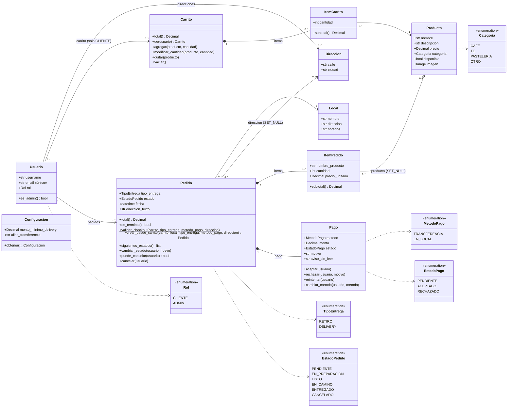

# Diagrama de clases — Lately Café

Generado a partir de los modelos actuales (`usuarios/models.py`, `menu/models.py`, `carrito/models.py`, `pedidos/models.py`).

Notas de lectura:

- `Configuracion` y `Local` no tienen relación con otras clases por FK: `Configuracion` es una fila única (pk=1) consultada por `Pedido.validar_checkout`; `Local` solo lo referencia `Pedido`.
- `1..*` en `Pedido → ItemPedido` es una regla de `crear_desde_carrito` (rechaza carrito vacío), no una restricción de base de datos.
- `Pago` es `OneToOne` con `Pedido`; se crea siempre junto con el pedido.
- Estado del pedido y estado del pago son independientes: ninguno cambia al otro automáticamente.

## Clases y reglas de negocio

| Clase | Para qué sirve | Reglas de negocio que implementa |
|---|---|---|
| Usuario | Cuenta de acceso (`AUTH_USER_MODEL`), con rol CLIENTE o ADMIN. | Email único. Rol por defecto CLIENTE; el superusuario se crea con rol ADMIN (`UsuarioManager`). |
| Direccion | Direcciones de entrega guardadas por un usuario. | Pertenece a un usuario (se borra con él). Para delivery debe ser del dueño del carrito. |
| Producto | Ítem del menú con precio, categoría y disponibilidad. | Solo los productos `disponible` pueden agregarse al carrito o confirmarse en un pedido. |
| Local | Sucursal donde se retira o desde donde se atiende el pedido. | Todo pedido referencia un local (`PROTECT`: no se puede borrar un local con pedidos). |
| Configuracion | Parámetros editables por el ADMIN: monto mínimo de delivery y alias de transferencia. | Fila única (`save` fuerza `pk=1`; `obtener()` la crea con 500 y `lately.cafe`). El monto mínimo debe ser > 0. |
| Carrito | Carrito de compras del cliente (uno por usuario). | Solo CLIENTE tiene carrito (`de` lanza `PermisoError` para ADMIN). Cantidad ≥ 1 y producto disponible al agregar/modificar. `modificar_cantidad` exige que el producto esté en el carrito. |
| ItemCarrito | Producto y cantidad dentro de un carrito. | Único por (carrito, producto): agregar de nuevo suma cantidad. `subtotal` usa el precio vigente del producto. |
| Pedido | Compra confirmada: local, tipo de entrega, estado y dirección. | Checkout (`validar_checkout`): carrito no vacío; productos disponibles; en delivery, total ≥ monto mínimo, solo transferencia y dirección propia. Copia el texto de la dirección. Transiciones solo al siguiente estado (PENDIENTE→EN_PREPARACION→LISTO→[EN_CAMINO]→ENTREGADO), solo ADMIN. EN_CAMINO solo en delivery. Cancelación: ADMIN en PENDIENTE/EN_PREPARACION; CLIENTE dueño solo en PENDIENTE. |
| ItemPedido | Línea del pedido con copia de nombre y precio. | Congela `nombre_producto` y `precio_unitario` al confirmar; sobrevive al borrado del producto (`SET_NULL`). |
| Pago | Pago único del pedido, con método, monto y estado. | Nace PENDIENTE con el total del pedido. Delivery solo admite TRANSFERENCIA. ADMIN acepta o rechaza (rechazo exige motivo) solo desde PENDIENTE y con pedido no cancelado. CLIENTE dueño puede reintentar (RECHAZADO→PENDIENTE) o cambiar método (solo PENDIENTE y pedido no terminado). Aceptar/rechazar deja un aviso en pantalla y envía email. |

## Diferencias con el modelo de dominio de la Entrega 2

| Concepto | Estado en el código |
|---|---|
| Usuario | Implementado como `Usuario` con rol CLIENTE/ADMIN. Hereda de `AbstractUser`, por lo que incluye campos de Django (username, nombre, etc.) que no se muestran en el diagrama. |
| Dirección | Implementado como `Direccion` con solo `calle` y `ciudad`. El `Pedido` guarda además una copia en texto (`direccion_texto`) y la FK pasa a NULL si la dirección se borra. |
| Carrito | Implementado, con `ItemCarrito` como clase intermedia. Solo existe para CLIENTE. |
| Pedido | Implementado, con `ItemPedido` (precio congelado) y estados propios. Incluye `Local` y `tipo_entrega`, que son parte del código actual. |
| Pago | Implementado como clase separada 1 a 1 con Pedido, con estado propio (PENDIENTE/ACEPTADO/RECHAZADO). No hay pasarela de pago: aceptar/rechazar es una acción manual del ADMIN. |
| Local | Implementado con `nombre`, `direccion` y `horarios` (texto libre). No tiene relación con productos ni stock. |
| Clase | **No implementado.** No existe ninguna clase o modelo con ese nombre ni concepto equivalente. |
| Inscripción | **No implementado.** |
| SolicitudEspecial | **No implementado.** |
| Publicación | **No implementado.** |

Elementos presentes en el código que no figuran en la lista de conceptos pedida: `Producto`, `Configuracion`, `ItemCarrito`, `ItemPedido` y los enums `Categoria`, `TipoEntrega`, `MetodoPago`.
