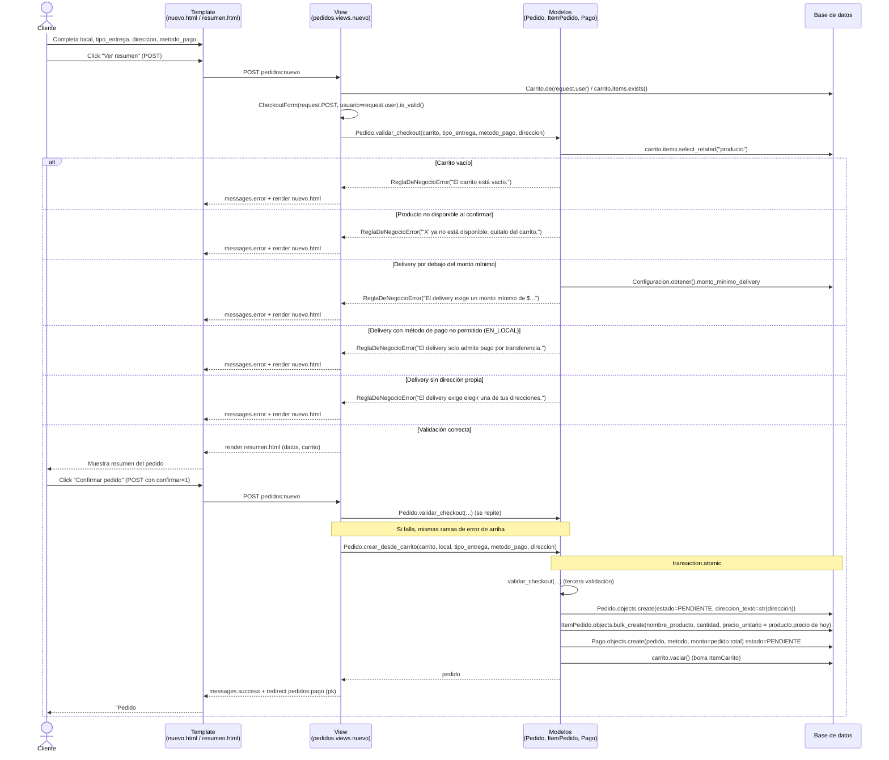

# Diagrama de secuencia — El cliente confirma un pedido

Flujo real de la vista `pedidos.views.nuevo` (URL `pedidos/nuevo/`, name `pedidos:nuevo`), protegida con `rol_requerido(Rol.CLIENTE)`. Es un mismo formulario (`CheckoutForm`) en dos pasos: "Ver resumen" y "Confirmar pedido" (`name="confirmar"`).

Notas:

- Si `tipo_entrega` no es DELIVERY, `crear_desde_carrito` fuerza `direccion = None`.
- Las ramas de error son excepciones `ReglaDeNegocioError` que la vista captura en un `try/except` propio dentro de `nuevo` (no usa `config.reglas.ejecutar`). El orden de las validaciones es el de `Pedido.validar_checkout`.
- Si `CheckoutForm` no es válido (por ejemplo, local o método inexistente), la vista vuelve a renderizar `nuevo.html` con los errores del formulario, sin llegar a los modelos.
- Si el carrito está vacío al entrar a la vista, redirige a `carrito:ver` con "Tu carrito está vacío." antes de procesar el formulario.
- Si `crear_desde_carrito` falla a mitad de camino, `transaction.atomic` revierte todo y el carrito queda intacto.
